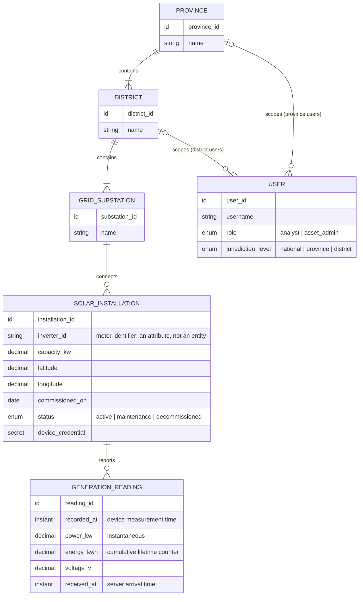

# Data Model (WSO2 §3: the model comes before resources and URIs)

This model is implementation-independent. It names entities, attributes and cardinalities, but no storage types, formats or URIs. The physical schema in `db/schema.sql` is derived from it.

## Cardinalities

| Relationship | Cardinality | Note |
|---|---|---|
| Province → District | 1 to 1..* | 9 provinces, 25 districts |
| District → GridSubstation | 1 to 1..* | every district has at least one substation |
| GridSubstation → SolarInstallation | 1 to 0..* | a new substation may have no sites yet |
| SolarInstallation → GenerationReading | 1 to 0..* | a newly registered site has no readings yet |
| User → jurisdiction | national: none; province: exactly 1 Province; district: exactly 1 District | enforced by a CHECK constraint |

## Decisions that carry marks

1. **`inverter_id` is an attribute of SolarInstallation, not a Device entity.** Each rooftop site has one reporting inverter, and the device only exists to report for that site. A Device entity would only earn its place if the system had to track device replacement, firmware or calibration history, which is out of scope. The device's credential is also stored on the installation, because the device authenticates *as* the installation.
2. **GenerationReading is its own append-only time series**, not `last_power` fields on the installation. Last-value fields would destroy the analytical (historical) scope. The "latest reading" is *derived* from the series, which gives the `last-reading` processing resource. Append-only is enforced by a database trigger that rejects UPDATE and DELETE.
3. **Added field `received_at`** (beyond the brief's minimum). `recorded_at` is the device's clock, used for analytics; `received_at` is the server's clock, used for audit. The gap between the two exposes device clock drift or replayed or buffered uploads without trusting the device.
4. **`energy_kwh` is cumulative**, as on a real meter. Daily energy is derived as the difference between the day's last and first counter values, which is robust to missed readings.
5. **Write and read concerns are separate entities.** Devices (write clients) are represented by the installation's credential. SLSEA people (read clients) are Users with a jurisdiction. The model has no path for a User to be a data producer.
6. **Deletion is soft.** Decommissioning an installation keeps its readings, because generation history is an audit record.
